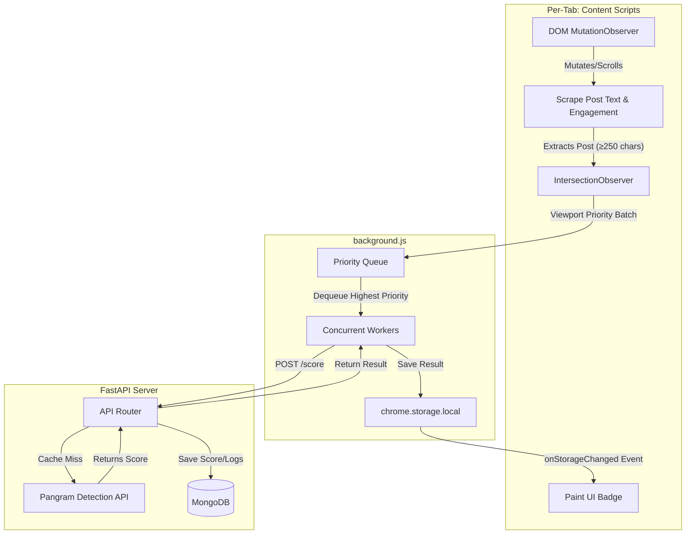

# Social AI Research - Project Overview

This repository contains the data-collection instrument for a research study measuring exposure to and engagement with AI-generated content on social media feeds.

## 1. Things You Need to Understand First

Before modifying the codebase, familiarize yourself with these key design nuances and quirks:

### The "Selector Cascade" (LinkedIn DOM Variations)
LinkedIn ships multiple HTML variations of their feed simultaneously. Some users see `
`, while others see `
` without any roles. The codebase handles this by attempting a cascade of different CSS selectors to ensure posts are found regardless of the A/B test variant the user is currently on.

### Viewport Priority Loop
Participants scroll quickly, generating hundreds of scoring requests. Instead of a FIFO queue, the extension tracks post visibility using an `IntersectionObserver`. Posts currently in the viewport get priority `100`, while posts scrolled past get lower priorities. The Service Worker fetches scores for the highest-priority posts first to ensure the user sees badges on what they are currently looking at.

### English Locale Dependency
Since LinkedIn does not use reliable CSS classes for engagement metrics (likes, reposts) or post body containers, the extraction logic relies on parsing English text like `"Follow"` or `"Like"`. Participants should ideally use the English UI for the most accurate tracking.

### CSS Grid Quirks on X (Twitter)
X structures its posts using CSS Grid. If you inject the AI badge directly into the root `<article>`, it breaks the layout by squeezing into the narrow avatar column. The script (`twitter.js`) instead walks the DOM tree to safely inject the badge into the content column.

### Throttled MutationObserver
Because LinkedIn uses virtualization (unloading and reloading elements as you scroll), posts must exist in the DOM long enough for the throttled scraper (~800ms) to read them. Extremely fast scrolling may leave behind empty wrappers that the scraper rightfully ignores as "too short".

---

## 2. Technologies & Hosting Platforms

### Frontend (Chrome Extension)
- **Framework:** Vanilla JavaScript (ES Modules, no framework).
- **Manifest:** Chrome Extension Manifest V3 (MV3).
- **Build Tool:** Custom lightweight Node.js script (`build.js`) - no heavy bundlers.
- **Storage:** `chrome.storage.local` (Local, in-browser storage)
- **Hosting:** Not published to the Chrome Web Store. Loaded locally by participants via Chrome's "Load Unpacked" during the study.

### Backend (API Server)
- **Framework:** FastAPI (Python 3.14).
- **Database:** MongoDB (via Motor async driver) - Stores participant identities, observations, interactions, and cached scores.
- **AI Detection API:** Pangram V3 API (External service for text scoring).
- **Hosting:** (Phase 1) Local development server. (Phase 4) Production deployment behind Apache or similar reverse proxy.

---

## 3. Data Flow Architecture

The data flow is distributed across the browser tab, the extension's service worker, and the backend.

---

## 4. Full Feature Set

### Extension Features
- **Silent Feed Scraping:** Observes the DOM in real-time on X.com and LinkedIn.com to extract post bodies, authors, and engagement metrics.
- **Viewport Tracking:** Tracks which posts the user is actually looking at and prioritizes fetching their scores first, conserving API rate limits and bandwidth.
- **AI-Detection Scoring:** Offloads processing to the Pangram API to score whether text is `Human`, `AI`, or `Mixed`.
- **In-DOM Badging:** Dynamically injects colored visual indicators (`HUMAN`, `AI`, `MIXED`, `TOO SHORT`, `SCORING`, `ERROR`) onto posts based on their score.
- **Researcher Dashboard (Popup):** Extension popup allows participants/researchers to clear local storage, test the API, rescore failures, and export JSON data.
- **A/B Testing Identity:** Automatically assigns users to a `control` or `treatment` group upon installation. (Control users don't see badges, but their feed data is still securely logged).

### Backend Features
- **Stateless Authentication:** Mints and verifies unique participant ID tokens upon the first extension launch. No password or email needed.
- **Caching & Deduplication:** Caches Pangram API scores via `postId` or `textHash` to avoid paying for duplicated score requests.
- **Event Logging:** Records every post observation (when seen) and interactions (like, repost, click) asynchronously into MongoDB for downstream analysis.
- **Rate Limiting:** Protects the Pangram API and backend from spam or accidental DoS from fast-scrolling participants.
- **Admin Dashboard:** Includes server-side rendered HTML templates (`/admin/`) to view registered participants, monitor API usage, and export data.
